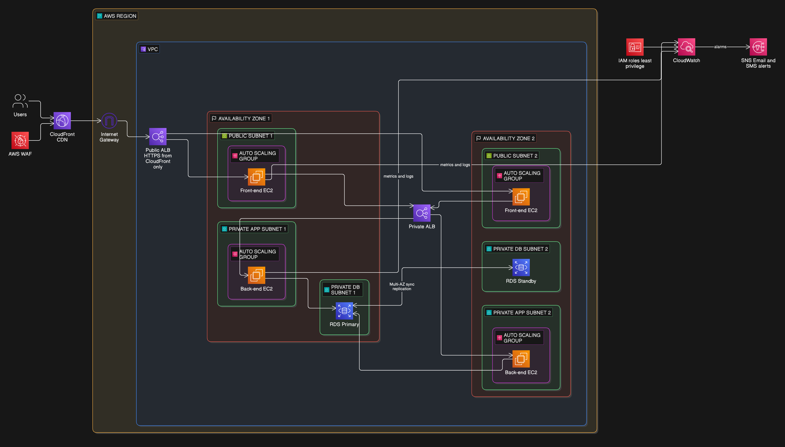

# Scalable and Secure AWS Architecture for Web Applications

An enterprise-grade, three-tier web architecture on AWS. Each component is
placed deliberately inside the VPC to enforce security boundaries, deliver
performance, and give operational visibility.

## Architecture at a Glance

| Layer | Services | Location |
|---|---|---|
| Edge | CloudFront, AWS WAF | Global edge |
| Public access | Internet Gateway, Public ALB | Public subnets |
| Front end | EC2 in Auto Scaling Group | Public subnets |
| Application | Private ALB, EC2 in Auto Scaling Group | Private subnets |
| Data | Amazon RDS (Multi-AZ) | Private subnets |
| Operations | CloudWatch, SNS, IAM | Regional services |

**Request flow:**
`Users → CloudFront + WAF → Internet Gateway → Public ALB → Front-End EC2 → Private ALB → Back-End EC2 → RDS`

## Network Layout

The VPC spans **two Availability Zones**. Each AZ contains **three subnets**
(six in total):

- 1 public subnet (Public ALB and front-end EC2)
- 2 private subnets (back-end application tier and RDS)

> **Note:** For readability, the diagram does not show the individual subnets
> or security groups. They are described in this document.

## Components

### 1. Edge Security and Content Delivery
- **Amazon CloudFront** is the global CDN. It caches static and dynamic
  content near users, which improves performance and reduces load on origins.
- **AWS WAF** is attached to CloudFront. It blocks common exploits (SQL
  injection, XSS) and helps absorb DDoS attempts. Together they form the
  first line of defense.

### 2. Public Access Layer
- The **Internet Gateway (IGW)** provides controlled inbound and outbound
  access for resources in the public subnets.
- The **Public Application Load Balancer** spans both AZs for fault
  tolerance and terminates client connections.
- Its security group allows **HTTPS only from CloudFront**, so every external
  request has already been inspected by WAF.

### 3. Front-End Tier
- EC2 instances in an **Auto Scaling Group** across both AZs host the
  front-end application (e.g., React or Angular).
- Auto Scaling adjusts capacity to demand. Spreading instances across AZs
  provides high availability.

### 4. Private Application Layer
- The front end calls a **Private ALB** in the private subnets. It is not
  reachable from the internet.
- The Private ALB routes to **back-end EC2 instances** (Node.js, Java, Python,
  etc.) in private subnets.
- Back-end security groups accept traffic **only from the Private ALB**.

### 5. Database Layer
- **Amazon RDS** (MySQL or PostgreSQL) runs in private subnets with no direct
  internet access.
- The DB security group accepts connections **only from the back-end EC2
  instances**.
- **Multi-AZ** is enabled: a standby replica in the second AZ takes over
  automatically if the primary fails.

### 6. Monitoring, Logging, and Notifications
- **Amazon CloudWatch** collects metrics and logs from front-end and back-end
  EC2 instances.
- When a threshold is breached, CloudWatch publishes to **Amazon SNS**, which
  notifies administrators by email or SMS in real time.
- CloudWatch holds the IAM permissions it needs to trigger these responses.

## Security Controls

| Control | Purpose |
|---|---|
| AWS WAF | Filters malicious traffic at the edge |
| CloudFront | DDoS mitigation and encryption in transit |
| Security groups | Restrict traffic between tiers (ALB → front end → Private ALB → back end → RDS) |
| IAM roles and policies | Least-privilege access for CloudWatch, EC2, and RDS |
| Private subnets | Keep the back end and RDS off the internet |

## High Availability and Scalability

- Resources are distributed across **two Availability Zones** to tolerate
  failures.
- **Auto Scaling** scales the front-end and back-end tiers dynamically.
- **RDS Multi-AZ** gives the database automatic failover.
- **CloudFront and the ALBs** spread traffic efficiently across resources.
