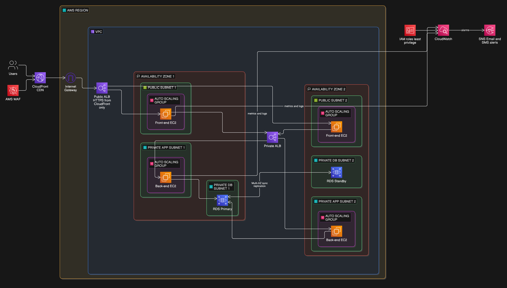

# Scalable and Secure AWS Architecture

A reference design for a highly available, three-tier web application on AWS. It outlines edge protection, public and private application tiers, and a Multi-AZ database deployment across two Availability Zones.

## Request flow

`Users -> CloudFront + AWS WAF -> Public ALB -> Front-end EC2 -> Private ALB -> Back-end EC2 -> Amazon RDS`

## Design highlights

- CloudFront and AWS WAF protect and accelerate user traffic.
- Public and private load balancers route traffic between application tiers.
- Auto Scaling Groups and deployment across two Availability Zones support availability and scaling.
- Amazon RDS Multi-AZ provides database failover; the database remains in private subnets.
- CloudWatch and SNS provide monitoring and notifications.

## Project files

- [Detailed architecture](Architecture.md)
- [Project document (PDF)](manara%20project%20prof.pdf)
- [Architecture diagram](architecture.png)

This repository documents a proposed architecture; it does not contain deployment code or provision AWS resources.
